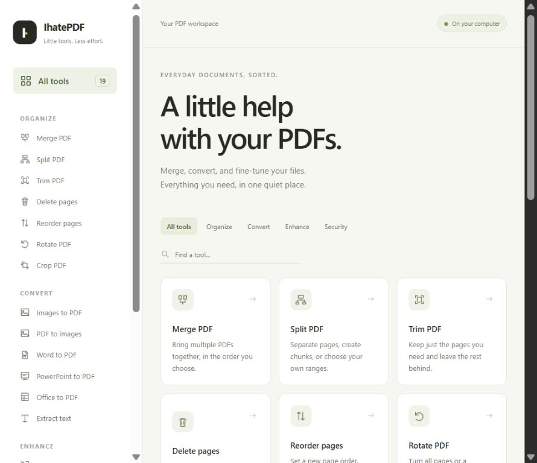

# IhatePDF

**PDF chores, without the upload.**

IhatePDF is a Python app with a minimal web interface for merging, converting,
organizing, and protecting documents. Run it on your computer, open your browser,
and get things done. No accounts, subscriptions, cloud uploads, or frontend build
step.



## Highlights

- **19 document tools** in one searchable interface.
- **Local processing:** files stay on your computer.
- **Drag and drop:** upload files or use the file picker.
- **Batch support:** process several documents in one operation.
- **Ordered merging:** rearrange uploaded files before combining them.
- **Simple downloads:** save individual results or get a ZIP of all outputs.
- **Originals stay untouched:** edits create new documents.

## Requirements

- Python **3.10 or newer**.
- A modern browser.
- **PPT/PPTX conversion:** Microsoft PowerPoint installed on Windows, or
  [LibreOffice](https://www.libreoffice.org/download/download-libreoffice/).
- **Word, Excel, and ODP conversion:** LibreOffice.

Python dependencies are installed with the commands below: Flask, PyMuPDF, and
Pillow, plus pywin32 on Windows for PowerPoint integration. Node.js and npm are
not required.

## Quick start

Clone or download this repository, open a terminal in its root folder, and choose
the commands for your operating system.

### Windows

```powershell
python -m venv .venv
.\.venv\Scripts\python.exe -m pip install -e .
python run.py
```

### macOS / Linux

```sh
python3 -m venv .venv
.venv/bin/python -m pip install -e .
python3 run.py
```

`run.py` automatically uses the project's virtual environment; activation is
optional. The app opens [http://127.0.0.1:8765](http://127.0.0.1:8765) in your
browser. If the browser does not open automatically, visit that address manually.

Keep the terminal running while using IhatePDF. Press **Ctrl+C** to stop it.

## Tools

| Tool | What it does |
| --- | --- |
| Merge PDF | Combines documents in your chosen order |
| Split PDF | Separates every page, fixed-size chunks, or custom ranges |
| Trim PDF | Keeps selected pages |
| Delete pages | Removes selected pages |
| Reorder pages | Changes page order, with repeated pages allowed |
| Rotate PDF | Rotates all or selected pages |
| Crop PDF | Trims visible page margins |
| Images to PDF | Combines images into one PDF |
| PDF to images | Exports pages as PNG or JPG with adjustable resolution |
| Word to PDF | Converts DOC, DOCX, ODT, and RTF files |
| PowerPoint to PDF | Converts PPT, PPTX, and ODP presentations |
| Office to PDF | Converts Office documents, including XLS, XLSX, and ODS spreadsheets |
| Extract text | Saves an existing PDF text layer as UTF-8 text |
| Compress PDF | Optimizes files, optionally reducing image quality and resolution |
| Watermark | Adds centered text or an image |
| Page numbers | Adds configurable numbering at the top or bottom |
| Protect PDF | Applies an AES-256 opening password |
| Unlock PDF | Removes encryption using a supplied password |
| PDF details | Shows page count, dimensions, metadata, and protection status |

## Using the app

1. Choose a tool from the grid or sidebar. Search and category filters help you
   find it quickly.
2. Drop files into the upload area or click **browse files**.
3. Adjust the visible settings. Use **More options** for protected input PDFs or
   a custom font.
4. Run the tool and download the results.

Multiple inputs enable batch processing. Merge and Images to PDF combine their
inputs into one file instead. A batch can return successful results alongside
errors for files that could not be processed.

### Page selections

Pages start at **1**. Supported selections include:

| Selection | Meaning |
| --- | --- |
| `1-5,8,last` | Pages 1 through 5, page 8, and the final page |
| `odd` / `even` | Odd-numbered or even-numbered pages |
| `all` | Every page |
| `last-1` | Every page in reverse order |
| `3,1,2,2` | A custom order with a repeated page, when reordering |

Reordering keeps only listed pages. Custom split ranges use semicolons between
output files, for example `1-3;4-last`.

### Passwords, fonts, and numbering

Enter an input PDF password under **More options**. A batch uses one shared input
password. **Output PDFs are unencrypted unless you use Protect PDF**, including
edits to protected inputs. Passwords are limited to 40 UTF-8 bytes.

For non-Latin watermark or numbering text, upload a TTF/OTF font containing the
required characters. Number formats accept `{page}`, `{total}`, and `{original}`;
for example, `Page {page} of {total}`.

## Office conversion setup

On Windows, IhatePDF automatically detects installed **Microsoft PowerPoint**
and uses its native PDF exporter for PPT and PPTX files, including those uploaded
through Office to PDF. No LibreOffice installation is needed for those files.
PowerPoint must be activated and able to open presentations normally.
Office's file-validation and file-block settings still apply. Some legacy PPT
files may be refused by PowerPoint; IhatePDF does not bypass those protections.

The Windows Python bridge, pywin32, installs automatically during setup. Existing
installations can update dependencies with:

```powershell
.\.venv\Scripts\python.exe -m pip install -e .
```

The converter opens a temporary copy read-only without a presentation window,
disables macros while opening it, and closes only that temporary presentation.
It does not quit your PowerPoint application or close other presentations. A
timeout stops the conversion worker; an Office dialog or temporary presentation
may need closing manually if PowerPoint gets stuck.

**LibreOffice** handles ODP, Word, and spreadsheet formats and is the fallback
when PowerPoint is unavailable or native conversion fails. Install LibreOffice
and restart IhatePDF if you need those conversions. Standard Windows installations are
detected automatically; on macOS/Linux, an executable available on `PATH` is
detected. If necessary, configure the executable explicitly with the environment
variable below.

```powershell
# Windows: custom LibreOffice executable
$env:IHATEPDF_LIBREOFFICE = "C:\Program Files\LibreOffice\program\soffice.com"
python run.py
```

```sh
# macOS: standard application location
export IHATEPDF_LIBREOFFICE="/Applications/LibreOffice.app/Contents/MacOS/soffice"
python3 run.py
```

LibreOffice uses a private profile. Both converters have a configurable timeout
and validate the resulting PDF. The UI detects PowerPoint separately, so PPT/PPTX
conversion does not ask for LibreOffice when PowerPoint is available. Non-Office
tools work without either application.

## Configuration

Set environment variables before starting the app.

| Variable | Default | Purpose |
| --- | --- | --- |
| `IHATEPDF_PORT` | `8765` | Local web server port |
| `IHATEPDF_NO_BROWSER` | Unset | Set to `1` to skip automatic browser opening |
| `IHATEPDF_LIBREOFFICE` | Auto-detect | Path to the LibreOffice executable |

Example: run on a different port without opening a browser automatically.

```powershell
$env:IHATEPDF_PORT = "9000"
$env:IHATEPDF_NO_BROWSER = "1"
python run.py
```

```sh
IHATEPDF_PORT=9000 IHATEPDF_NO_BROWSER=1 python3 run.py
```

## Local files and limits

- The server listens on **127.0.0.1 only**. It is designed for local use, not
  public hosting or use from another device.
- Each operation accepts **up to 100 input files and 256 MB of request data**.
- Uploads are stored in isolated temporary folders. Inputs are deleted after
  successful processing; failed jobs are removed.
- Downloads are available for **one hour** while the app is running. The next
  request cleans up expired jobs.
- A normal shutdown removes the session's temporary working directory. If the
  process is forcibly terminated, leftover files may remain under `tmp/`.
- Download results before stopping the app. Originals are never changed.

## Limitations

- **No OCR or PDF-to-editable-Word conversion.** Text extraction needs an existing
  text layer; image-only pages produce no text.
- **Compression savings vary.** Already optimized PDFs can grow. Lossy mode
  changes embedded images while retaining text and vector content.
- **Cropping is visual, not redaction.** Content outside the visible crop box
  remains in the document. Margins use points: 72 points = 1 inch.
- **Office fidelity depends on the chosen converter and installed fonts.** Complex
  layouts can differ from the original. Password-protected Office files are
  unsupported. Native PowerPoint conversion is available only on Windows.
- PDF rewrites can invalidate digital signatures and may not preserve every
  unusual document-level feature.
- Images to PDF uses the first frame of animated or multi-frame image files.

## Development

Install the development dependencies and run the tests:

```powershell
.\.venv\Scripts\python.exe -m pip install -e ".[dev]"
.\.venv\Scripts\python.exe -m pytest -q
```

```sh
.venv/bin/python -m pip install -e '.[dev]'
.venv/bin/python -m pytest -q
```

Tests cover PDF content, page geometry, password round-trips, compression, upload
validation, batching, ZIP downloads, temporary file cleanup, and local request
protection. Office subprocess unit tests use simulated outputs; native PowerPoint
PPTX conversion has also been checked with a generated presentation on Windows.
The legacy PPT sample was refused by Office file validation on the test machine.
Real Office conversion should be checked with representative documents and fonts.

The UI is server-rendered HTML with CSS and plain JavaScript. PDF processing runs
sequentially because PyMuPDF is not thread-safe.

```text
.
├── run.py                  # Starts the local web app
├── pyproject.toml          # Package metadata and dependencies
├── requirements.txt        # Runtime dependencies
├── docs/images/            # README screenshots
├── src/ihatepdf/
│   ├── server.py           # Local server and browser launcher
│   ├── web.py              # Upload, processing, and download routes
│   ├── catalog.py          # Tool definitions and settings
│   ├── core.py             # PDF and image operations
│   ├── office.py           # Converter detection, routing, and LibreOffice
│   ├── _powerpoint.py      # Native PowerPoint conversion worker (Windows)
│   ├── pages.py            # Page-selection parser
│   ├── output.py           # Safe output publishing
│   ├── templates/          # HTML
│   └── static/             # CSS and JavaScript
├── tests/                  # Automated tests
└── examples/demo.py        # Generates demonstration documents
```

Generated documents, temporary files, virtual environments, and caches are
excluded from Git by `.gitignore`.

## Contributing

Bug reports and focused pull requests are welcome. Describe the steps to reproduce
an issue and expected behavior. Use synthetic or anonymized documents when
sharing a sample. For code changes, run the existing test suite and add a focused
regression test when appropriate.

## Licensing

A project-level license has not yet been selected; this repository currently has
no `LICENSE` file. Dependencies retain their own licensing terms.
[PyMuPDF and MuPDF](https://pymupdf.readthedocs.io/en/latest/about.html#license-and-copyright)
are offered under AGPL and commercial license agreements.

